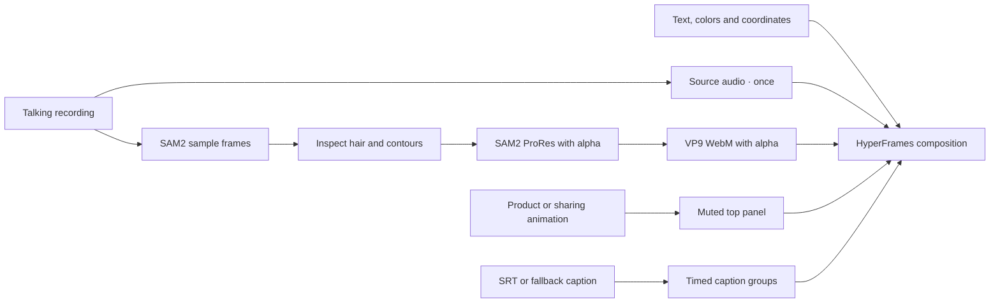

# News remake architecture

The reusable composition has three independently replaceable regions: visual content above, captions between, and a real talking-person video below. The person is not a solid silhouette illustration: their original face, clothes and motion remain visible. Only the surrounding pixels outside the rounded scene card become transparent.

## Current implementation

`template.json` is the source of truth. `scripts/hyperframes-project.mjs` validates inputs, probes media, resolves the matching prepared persona and builds `index.html` from `scripts/news-channel.html`. The paused GSAP timeline is registered as `window.__timelines['news-channel']`. HyperFrames owns media timing, playback and frame rendering.

The local editor uses Node's built-in HTTP server on loopback port 3018. It accepts video and SRT uploads, copies them into the project, saves validated configuration and provides a still layout preview. Its static-preview helper is injected only into the editor iframe; it is not present in the rendered HyperFrames composition. HyperFrames Studio runs separately on port 3017. The project route derives from the directory name, the workspace project route is `#project/editorial-explainer`.

## Bottom-video geometry

The 1080 × 1920 reference uses roughly the bottom third for the speaker:

| Region | Bounds |
| --- | --- |
| Person region | x=0, y=1280, width=1080, height=640 |
| Head top | approximately y=1290, about 630px / 32.8% above the bottom |
| Original scene card | x=64, y=1420, width=952, height=500 |
| Card corners | 64px top radius |

The SAM2 tool already combines the person alpha with the scene-card mask. The browser layer therefore contains both the rounded original background and the person above it. It must not be placed over another copy of that background: the template uses one `persona-overlay` video for this mode.

The full 1080 × 1920 alpha layer is retained, rather than cutting it at y=1280, so moving hair or raised hands above the expected head boundary are not accidentally cropped. It is positioned at top=-1280 inside the persona region. Moving or resizing the persona wrapper moves both the scene and person together; its width controls proportional scaling.

When no matching prepared layer exists, the template previews a crop of the original recording in a rounded window. This preview needs no AI model download. The raw crop supports portrait or landscape media, scales to cover 1080 × 640, and validates `cropY`. It is an editing fallback, not a claim that a cutout has been generated.

## SAM2 bridge

The local dependency is `../../tools/sam2` (override with `SAM2_DIR`). Its `.venv`, Core ML models and script are reused in place. The bridge always runs the script from that repository and writes new output directories under this project's `.cache/sam2/`.

1. `sam2:test` samples five frame indices spread across the recording.
2. The user inspects the generated pictures, shown in the setting page and available as full-size images.
3. `sam2:prepare` runs the complete recording with the same layout flags and ±2-frame mask smoothing.
4. ProRes 4444 output is converted to muted VP9 WebM with alpha.
5. Width, height, duration, source frame count where available, and the alpha declaration are checked before publishing the new layer.

The prepared-layer fingerprint includes the source file content and segmentation/framing settings. Text edits and subtitle moves reuse the existing layer. Replacing the person or changing the scene card invalidates it, so an old speaker cannot remain over new audio. The new layer is published only after conversion and validation succeed.

This Core ML model segments frames independently. The local tool derives a face-based prompt, holds one placement for the clip, and smooths masks over time. It is suited to one relatively stationary speaker and a fixed camera; walking subjects, camera pans and shot changes need another tracking workflow or per-shot preparation. Fine hair uses softened segmentation edges, not full hair matting.

## Media and captions

- Current talking source: `source/character-talking.mp4`, 1080 × 1920, 25 fps, 509 frames, 20.36 seconds.
- Its SHA-256 matches the example input in the user's SAM2 repository.
- Top visual: `assets/visuals/content.mp4`, extracted from the original reference panel, 18.7667 seconds. It holds its final frame for the rest of the episode.
- One audio clip references the original talking recording. All video elements are muted and use the same start time.
- `source/character-talking.srt` contains 10 caption groups transcribed from this example. These are editable approximate timings.
- New uploads clear the previous SRT selection. Provide a new SRT or use the editable fallback caption.
- No automatic caption transcription UI is implemented.

Track indices are distinct for the poster, top video, persona, captions and narration. Caption cues on one track cannot overlap. Media clips are not nested inside timed wrappers. Text and colors are escaped or validated before writing the composition.

## Content and layout controls

The setting page exposes the two video inputs; brand; two-line headline; visual label; SRT/fallback subtitle; background, ink and accent colors; and six layout groups. Each group has X/Y/width/height; text groups also have a font size and the top panel has a corner radius. The persona region maintains its 1080:640 aspect ratio when resized.

Changing fields updates the still layout preview. Saving validates bounds against the 1080 × 1920 canvas, rebuilds the composition and lets HyperFrames reload it. File uploads save automatically. Direct edits to the generated `index.html` can be overwritten; lasting edits belong in the setting page, `template.json`, or the source HTML template.

## Reference analysis

The original reference is `source/free-skills-share.mp4`: 1080 × 1920, 30 fps, 563 video frames, 18.7667 seconds. Its top animation, captions and speaker share a stable layout while the content advances through hook, evidence, demonstrations, summary and call to action.

- `analysis/keyframes.json`: selected frame numbers and timestamps.
- `analysis/keyframes/`: 12 full-resolution key frames.
- `analysis/keyframes-contact-sheet.jpg`: the visual sequence.
- `analysis/timeline.json` and `analysis/subtitles.srt`: the reference's scene/caption timing.
- `templates/template-image.png`: an earlier concept image; its solid persona shape was only a placeholder.

Reference product claims are copied as sample content, not independently verified statements.

## Verification and current limits

The current example's imported SAM2 layer has been decoded and inspected. It has alpha mode 1, 1080 × 1920 pixels, 509 frames and 20.36-second duration. Hair/head silhouette and the opaque rounded scene card were visible in the alpha inspection. Five example test frames were viewed, plus a decoded WebM composite.

HyperFrames lint passed with no errors or warnings. `npm run verify` passed media timing, single-audio, stale-cutout invalidation, replacement-source duration, caption escaping, landscape crop, layout bounds, path isolation and local-request validation checks.

Browser interaction, contrast/layout inspection and a complete rendered composition remain unverified: the managed session forbids listening on local ports and its Chrome process aborts during HyperFrames check. The template can be launched from a normal user Terminal. See the monorepo root README for installation and repository setup.
